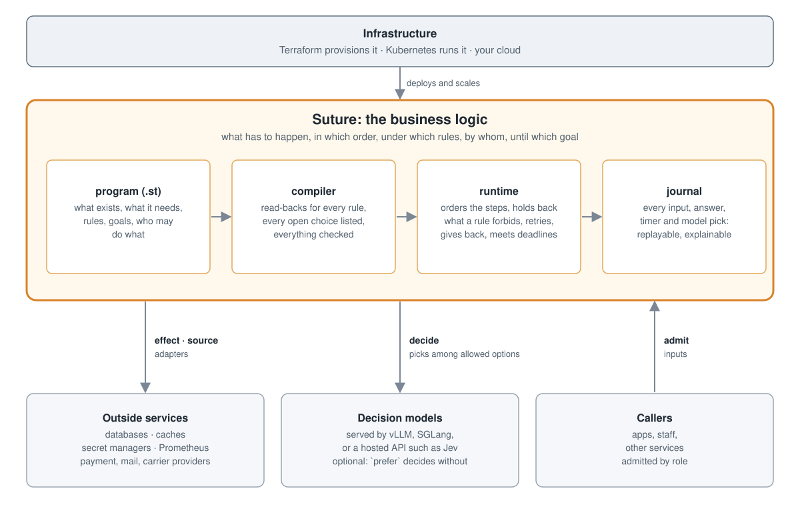

# Suture

**Stop writing the glue. Declare the rules.**

Most backend code isn't business logic. It's coordination: call this provider, retry on timeout, roll back if a later step fails, check that the seat is still free, make sure nobody approves their own expense, keep a state machine for every order and log what happened in case someone asks. It's hard to read, easy to get wrong, and it's where the bugs live.

Suture is a declarative language for that code. You state what exists, what each thing needs, the rules that must never break and the goals to reach, in controlled English. The runtime works out the order. It waits when a rule says so, retries what times out, gives back what a cancelled step took, and journals every step, so the same inputs always give the same result.

```text
rule seats: the total quantity taken from each Session is at most its seats
rule early: no Booking has a Ticket that is sent unless it is paid
desired within 1 day: every Booking that is not cancelled is paid and issued
```

Those three lines are the whole ordering, capacity and alerting logic of a ticketing system. There is no `if`, no loop and no call order.

> **Status:** v0 prototype. It has a Rust compiler and runtime, an HTTP service with a durable log, replay and multi-pod serving, and a guide whose every example is compiled and run by the test suite. It is not production software yet. Read [the limits](docs/guide/16-limits-of-v0.md) before betting on it.

## The numbers

We ported three real workflows to Suture, two of them from open-source projects whose code we didn't write, and counted. Each `eval/` folder has the ported program, the scenarios, a script that does the counting, and a write-up that includes where Suture lost.

| Workflow | Suture | The original | Control flow in Suture |
|---|---|---|---|
| **Leave applications**, ported from [frappe/hrms](https://github.com/frappe/hrms), with 16 of its tests turned into scenarios | **41 lines** | 487 lines of Python, in 29 functions | none |
| **Returns**, ported from [Solidus](https://github.com/solidusio/solidus), with 8 real changes from its git history replayed | **82 lines** | 661 lines of Ruby | none |
| **Motor claims**, with a model reading the photo and the invoice, against a hand-written Rust baseline | **62 lines** | 464 lines of Rust | none |

Changes are where the gap shows:

- **A new business rule is usually one sentence.** A yearly payout cap per policy cost Suture **+1** line and the Rust baseline **+43**. Overlapping leave cost **+2** lines; hrms spends 38 on it. Leave that runs across several applications is one rule; hrms spends 49 lines on it.
- **Some bugs can't be written.** Solidus fixed a bug in which one customer's return item could cancel another order's return items (`2741034ae`). In Suture a unit can't touch another unit, so that path never existed, and the fix was one `where` clause.
- **Suture doesn't always win.** In claims, adding a third payout type cost Suture +9 −4 lines against the baseline's +5 −4. In returns, adding a new reception state first cost Suture twice what it cost Solidus, until slice 25 added a state form. Each loss went on the roadmap. The write-ups list them all: [claims](eval/claims/RESULTS.md), [returns](eval/returns/RESULTS.md), [leave](eval/leave/RESULTS.md).

### Rules against prompting

On [RuleArena](https://github.com/skyriver-2000/RuleArena)'s airline task, a model reads the trip and the bags and Suture computes the fee:

| On 244 test cases | Right |
|---|---|
| **Suture**, with the facts read by a typed model | **100%** |
| `gpt-oss-120b` writing a Python program per case | 27.9% |
| `gpt-oss-120b` asked for the answer | 21.3% |

The models fall apart as cases grow: with 11 items, prompting got 8 of 76 right. Suture got all 76. These are early numbers: we wrote the Suture rules ourselves, the comparison model is a cheap one, and the cases come from one template. Rules written by an LLM, a reasoning model, and reworded cases come next. [The write-up](eval/rules/RESULTS.md) lists every caveat.

## What you stop writing

| You'd normally write | In Suture |
|---|---|
| step ordering, sagas, workflow definitions | `needs` plus rules; the runtime finds the order |
| retries, timeouts, dead-letter handling | an `effect` with a deadline and the outcomes it may report |
| compensation on cancel | nothing; a part that's no longer needed is withdrawn and gives back what it took |
| capacity and double-booking checks, locks | `rule … is at most its seats`, checked per group before anything happens |
| a state machine per entity | state attributes and `define`d states |
| permission checks scattered across handlers | `admit … by ⟨role⟩ where …`, checked at one gate |
| "why is this order stuck?" log diving | `suture explain`, which says what it waits on, which rule holds it, and what is due when |
| replay and audit infrastructure | built in: every input, answer, timer and choice is journaled |

## A whole program

Here is a complete ticketing system ([`examples/tickets/tickets.st`](examples/tickets/tickets.st)). Fans book seats, the system charges them, finds a session with room and mails the ticket:

```text
module tickets version 1, currency EUR

role fan is a Fan
role box

kind Fan     { name: Text }
kind Show    { name: Text, price: Money }
kind Session { show: Show, day: Text, seats: Count }
kind Booking { fan: Fan, show: Show, quantity: Count,
               total: Money = show's price * quantity,
               cancelled: Bool = no }
kind Payment { booking: Booking, amount: Money = booking's total }
kind Ticket  { booking: Booking }

Booking needs Payment, Ticket while it is not cancelled
Ticket  uses  a Session where the Session's show is the Booking's show,
              taking the Booking's quantity

effect charge Payment via payments within 30 seconds
  sends    its amount
  reports  charged | fails with declined
effect issue Ticket via mailer within 10 minutes
  sends    the booking's fan's name
  marks    sent
  reports  issued

define: a Booking is paid when its Payment is charged
define: a Booking is issued when its Ticket is issued

rule seats: the total quantity taken from each Session is at most its seats
rule early: no Booking has a Ticket that is sent unless it is paid

desired within 1 day: every Booking that is not cancelled is paid and issued

when a Payment is declined: its Booking is cancelled
when a fan or box cancels a Booking: the Booking is cancelled

prefer Session: highest seats

admit book a new Booking by fan where the Booking's fan is the caller
admit cancel Booking by fan where the Booking's fan is the caller
admit cancel Booking by box
admit add a new Show or Session by box
admit change Session's seats by box
```

Nothing says "charge first, then issue": rule `early` holds the ticket back until the payment is charged. Nothing says "release the seats on cancellation": a cancelled booking no longer needs its ticket, so the unsent ticket is withdrawn and gives its seats back. Nothing says "retry the mailer": the effect's deadline does that.

## It's English, but it isn't ambiguous

Rules are written in controlled English: a fixed set of sentence patterns, each with exactly one meaning, read by an ordinary parser. No model is involved in compiling. For every rule, `suture build` prints the formula it understood, a paraphrase, and what checking it costs, so you and the person who owns the policy can both check that it reads what you meant:

```text
rule seats: the total quantity taken from each Session is at most its seats
  understood as:   for each Session s: taken_quantity(s) ≤ s.seats
  in other words:  each session on its own: the total quantity taken from it is at most its seats
  cost:            per-group

rule early: no Booking has a Ticket that is sent unless it is paid
  understood as:   for each Booking b: exists(t in b.Ticket where t is sent) implies b is paid
  in other words:  no booking ever has a ticket that is sent unless it is paid
  cost:            local
```

The build also lists every choice the program leaves open and who decides it, and warns about anything that could wait forever. A sentence it can't read gets the closest pattern it knows, as a suggestion that compiles. An editor language server (`suture lsp`) gives you these as you type.

## Tests read like the spec

Scenarios are written in the same style, and `suture run` prints every step the runtime took:

```text
scenario "a fan books two seats"
  gate: admitted: fan Ada books a new Booking B1
  B1  placed: cancelled no, fan Ada, quantity 2, show Hamlet, total 80 EUR
  B1  needs Payment
  B1  needs Ticket
  B1  Payment → charge via payments (amount 80 EUR)
        choice: Fri for B1/Ticket#1@Session
  Fri granted B1/Ticket#1@Session: 2 quantity taken
  B1  Ticket gets Session Fri
  B1  Ticket waits: rule early
        payments: charged   (B1/Payment#1)
  B1  Payment charged
  B1  Ticket → issue via mailer (name "Ada")
        mailer: issued   (B1/Ticket#1)
  B1  Ticket issued
  B1  goal met: every Booking that is not cancelled is paid and issued
  ✓ expect B1 is paid
  passed
```

Time is simulated (`when 3 days pass`, `when it is 2026-03-01`), providers are scripted (`when payments answers declined`), and every run is deterministic. No mocks, no sleeps, and no flaky tests.

## AI that can't break your rules

Suture never prompts a model and never generates code. Models are optional. When you use them, they do two narrow jobs:

- **Decide.** A program is full of small choices the rules leave open: which carrier, which garage, repair or write-off. `decide Outcome with model "assessor@1"` hands one to a decision model. The model is given only the options the rules already allow, and its pick is checked again. If it declines, is late, is unsure or fails, the program's own fallback is taken, and the trace says why.
- **Read.** `source Claim's amount via model "invoices@1"` reads a value off a document or a photo, with a minimum confidence and a fallback.

**Multimodal.** A model can look at an image, listen to a recording, watch a video or read a PDF before it decides or reads. Give an entity, or the options, an attribute of type `Media`:

```text
kind Claim { policy: Policy, photo: Media, invoice: Media, amount: Money, … }

decide Outcome with model "assessor@1"                 -- sees the photo, picks repair, write-off or cash
  at least 0.8 sure otherwise Writeoff                 -- not sure enough: write it off
source Claim's amount via model "invoices@1" within 10 seconds
  sends      its invoice
  asking     "the total the invoice charges"
  at least 0.8 sure
  otherwise  ask again after 1 hour
```

Media is stored once, by its SHA-256, and a unit holds only a reference: `photo (image/png, 48213 bytes, sha256 9f2c41d07a1b)`. Images (PNG, JPEG, GIF, WebP), audio (MP3, WAV, Ogg), video (MP4, WebM), PDF and text come in through `POST /media`, or as `file "dent.png"` in a scenario. No rule or formula can read media, so what the program means never depends on how a model saw a picture. The model still only picks among allowed options, or reads one typed value.

**Models can pick models.** A fast router can choose which model makes a choice, or leave it to `prefer`. The router only picks a name from a list, so it is a decision model too:

```text
decide Outcome with model "fast@1" or model "careful@1" or prefer,
  picked by model "router@1" within 100 milliseconds at least 0.7 sure otherwise model "careful@1"
```

How sure a model must be, and what is taken when it isn't, are in the program, not in a deployment's config. `suture build` shows both, so a reviewer sees them next to the rules. Without an `otherwise`, `prefer` picks by fixed criteria.

Every model answer is journaled, so replay never calls a model. With every model switched off, the system still runs. That makes Suture a governed runtime for AI decisions: a model can be wrong, but it can't take you past a limit, skip an approval or pay twice. See [chapter 15](docs/guide/15-decision-models.md) and [chapter 14](docs/guide/14-sourcing.md).

## What it guarantees

- **Rules hold.** Every change is checked against the rules before it happens. A step that would break one waits or is refused, and the trace names the rule.
- **Same inputs, same result.** Every input, answer, timer and choice is journaled. Replaying a journal rebuilds exactly the same state, and a journal won't replay under a changed program.
- **Only admitted inputs.** Callers have roles, and each `admit` says who may create, change or cancel what.
- **Data goes only where you allow it.** `secret` and `personal` fields reach only the adapters granted them, and `suture build` writes a manifest of what each adapter receives.
- **Safe deploys.** `suture deploy` checks a new version against the live units before it starts.

## Try it in two minutes

With Rust 1.85 or later:

```sh
git clone https://github.com/swalla02/suture
cd suture
cargo build --release -p suture-cli

target/release/suture build   examples/tickets
target/release/suture run     examples/tickets --scenario examples/tickets/tickets.scenario
target/release/suture explain examples/shop --scenario examples/shop/orders.scenario O1
target/release/suture serve   examples/tickets --listen 127.0.0.1:7878
```

`suture serve` takes inputs over HTTP and keeps its log in `examples/tickets/.suture`; [chapter 17](docs/guide/17-serving.md) walks through a session with `curl`. A [Dockerfile and Kubernetes manifests](docs/guide/22-containers.md) run it as pods sharing one log.

| Example | Shows |
|---|---|
| [`tickets`](examples/tickets) | the tutorial: bookings, payments, shared seats, cancellation |
| [`shop`](examples/shop) | an online shop with stock, carriers and refunds; `france.st` adds customs and excise for some orders only, without touching `shop.st` |
| [`workspaces`](examples/workspaces) | multi-tenant workspace provisioning |
| [`credit`](examples/credit) | a credit check fetched from a bureau, trusted for a day, with a fallback |
| [`returns`](examples/returns) | a decision model picking how a return is handled, with `prefer` behind it |
| [`eval/leave`](eval/leave/suture), [`eval/returns`](eval/returns), [`eval/claims`](eval/claims) | the three measured ports above |

## Where Suture fits

Suture is not infrastructure, and it doesn't replace your databases or providers. It replaces the coordinating code in the middle: the services written to sequence steps, call providers, retry, compensate, check permissions and keep state per entity.



| Around Suture | Runs as | Linked by |
|---|---|---|
| callers: apps, staff tools, partner systems | outside, through the ingress | `admit`: only admitted inputs get in |
| platform services: PostgreSQL, Redis, Vault, Prometheus | pods | `source` for facts; API keys from environment variables; metrics and alerts out |
| your services, and adapters to payment, mail and carrier providers | pods, which call out | `effect`, with a deadline and the outcomes it may report |
| decision and reading models, including vision, audio and document models | vLLM or SGLang pods on GPU nodes, or a hosted API | `decide` and `source … via model`, with `Media` attributes |

It's a good fit for workflows with many steps, outside services, shared resources and rules that must never break: bookings, orders and returns, claims, approvals, provisioning, rostering. It's a poor fit for heavy computation, UIs, or code that is mostly algorithms.

## The language, construct by construct

| Construct | Says |
|---|---|
| `kind` | what exists, with typed attributes (including `Media`: images, audio, video, PDFs), states, defaults and formulas |
| `needs`, slots | what each thing needs, under conditions; or one of several alternatives, tried in order with patience |
| `uses … taking` | a binding to a shared entity, such as stock, seats or a carrier, picked from a pool and checked by its rules |
| `effect` | how a step talks to an outside service: what it sends, what it may report, and its deadline |
| `rule` | what must always hold: per entity, per group, per period, or per day an entity spans |
| `define`, `desired` | named states, and the goals to reach within a deadline, with alerts when they are missed |
| `when` | reactions to outcomes and admitted events |
| `admit`, `role` | who may do what |
| `source` | facts fetched from outside, or read off a document by a model, with how long they are trusted and what to do when the fetch fails |
| `decide … with model` | which decision model, if any, makes an open choice |
| `keep` | a running total kept for dashboards and tests |

## Built for coding agents

Agents write most code now. Suture suits them for two reasons:

- **It's compact.** The ports above are 7 to 12 times shorter than the code they replace, so a whole system fits in an agent's context at once, and so does the language. `suture help` prints the core, every form with recipes and limits, in about 2k tokens; `suture help --for ⟨dir⟩` adds the details of the forms a module already uses, and each error names the topic to read. An agent reads what it needs instead of searching a guide.
- **It's understandable.** What the agent writes is English with one meaning per sentence, and `suture build` reads every rule back in plain words. You review the read-back and the scenarios, not the syntax, so you can check an agent's work without learning the language first.

```sh
suture init billing        # AGENTS.md, CLAUDE.md, and a module that passes
suture help                # every form, recipes and limits, about 2k tokens
suture help --for billing  # the details of the forms billing uses
suture check billing       # compile and run every scenario; traces only for what failed, --json for tools
```

Every example in the book compiles and passes in the test suite, so it never drifts from the language. In [the agent eval](eval/agents/RESULTS.md), a fresh agent given a plain-English spec read only the book, and finished with 43% fewer tokens and in a quarter of the time it took with the guide, meeting the same requirements.

## Learn it

**[The Suture guide](docs/guide/README.md)** is the place to start: a tutorial, one chapter per construct, modelling patterns, the limits of v0, and a [one-page reference](docs/guide/reference.md). Every program, error and scenario in it is compiled and run by the test suite.

The design is in the [language spec](docs/superpowers/specs/2026-10-14-suture-language-design.md). Its appendices describe each prototype slice, and what each one still leaves open.

## Inside

```text
src/        the kernel: an interaction-net machine with a journal, replay and explanations
lang/       the compiler: lexer, controlled-English parser, checker, read-backs, suggestions, LSP
runtime/    the interpreter and host: units, needs, rules, deadlines, shared entities,
            sources, choice points, model backends, and the service (log, HTTP API,
            adapters, clock, pods), on top of the kernel
cli/        the `suture` command: build, run, explain, serve, deploy, lsp
eval/       the three measured ports, with their counting scripts
docs/       the guide, the spec, the kernel IR (ir-spec.md), and research notes
examples/   the example systems above
```

```sh
cargo test --workspace     # compiler, runtime, guide, examples, evals, replay
```

Each running entity, with everything it owns, is one agent on the kernel. Messages between them, outside answers, timers and model picks all enter through the journal, which is why a run can be replayed and explained step by step. The kernel's design is in [`docs/ir-spec.md`](docs/ir-spec.md). The research notes Suture grew from are in [`docs/design-notes.md`](docs/design-notes.md).
